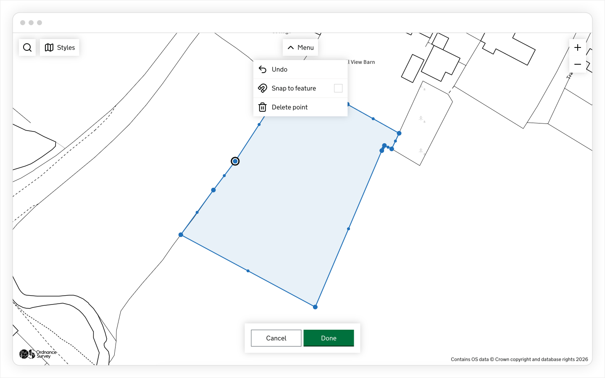

# InteractiveMap

[](https://github.com/defra/interactive-map/actions)
[](https://sonarcloud.io/summary/new_code?id=DEFRA_interactive-map)
[](https://www.npmjs.com/package/@defra/interactive-map-esri)
[](https://libraries.io/npm/@defra%2Finteractive-map-esri)
[](https://github.com/DEFRA/interactive-map/blob/main/LICENSE)

**InteractiveMap** is a lightweight map component designed for public-facing government services, and available for anyone to use.
Built to GOV.UK standards, with accessibility at its core, Interactive Map supports a wide range of users across abilities, devices and input methods.
It is open source and works with multiple mapping engines. The component can be extended through plugins to meet the specific needs of a service.

This package uses [Esri (ArcGIS)](https://developers.arcgis.com/javascript/latest/) to draw the map, and installs it for you. Use it for services that need the ArcGIS SDK. It has fewer features than the other packages, needs a bundler, and does not support a strict Content Security Policy.

It is an alternative to [`@defra/interactive-map`](https://www.npmjs.com/package/@defra/interactive-map), which uses MapLibre and suits most services. The packages work the same way and have the same imports, so only the package name changes.

```shell
npm install @defra/interactive-map-esri
```

See [examples of InteractiveMap](https://defra.github.io/interactive-map/examples).

See [getting started](https://github.com/DEFRA/interactive-map/blob/main/docs/getting-started.md) developer guide.

**⚠️ This project is currently in beta and is not yet stable.**

<p align="center">
  
</p>

## Documentation

[Getting started](https://github.com/DEFRA/interactive-map/blob/main/docs/getting-started.md)

[API Reference](https://github.com/DEFRA/interactive-map/blob/main/docs/api.md)

[Plugins](https://github.com/DEFRA/interactive-map/blob/main/docs/plugins.md)

[Building a Plugin](https://github.com/DEFRA/interactive-map/blob/main/docs/building-a-plugin.md)

[Architecture](https://github.com/DEFRA/interactive-map/blob/main/docs/architecture.md)

[Upgrading to v1](https://github.com/DEFRA/interactive-map/blob/main/docs/upgrading-to-v1.md)

## Contributing

To follow...
